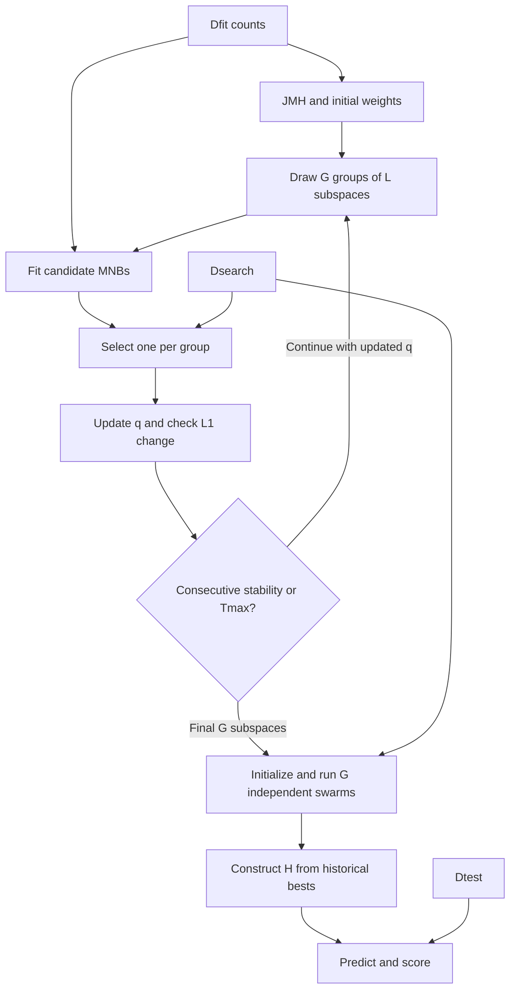

# Chapter 3 implementation mapping

Reviewed 2026-11-26 against thesis Git revision `059f00b643fd4e94ad0c8eb49b05ac2d9dd6be44`.
Authoritative entry point: `../Master-Thesis/main.tex`. Its active order is
`Chapter/First Chapter.tex`, `Chapter/Second Chapter.tex`, `Chapter/Third Chapter.tex`.
Chapter 3 includes `Chapter/chapter3-notation-table.tex` and
`figures/chapter3-method.pdf` (editable source `figures/chapter3-method.drawio`).
The standalone `notes/chapter3-notation.tex` is **not** included by `main.tex` and
contains superseded designs. Labels below are stable references; rendered equation
numbers (3.1–3.20) are derived from the active source order and should be rechecked
after revisions. Section numbers and stable LaTeX labels identify the source after edits.

## Scope and data contracts

`X_fit`, `X_search`, `X_test` are sparse CSR matrices with identical feature-column
order and finite nonnegative integer occurrence counts. `y_*` are one-dimensional
class labels aligned with rows. A persisted class order maps thesis classes
`1,...,M` to Python positions `0,...,M-1`; a persisted vocabulary maps thesis
features `1,...,d` to Python columns `0,...,d-1`. The feature list is fitted only
on `D_fit` as a conservative, explicit implementation policy. The active body
states the split purposes but omits vocabulary-learning scope; earlier supporting
notes alternate between `D_fit` and outer `D_train`. No test vocabulary learning
is permitted. See `open_questions.md` for this distinction.

Within each fold, fit-only JMH scores determine the initial weights. One seeded
sampling generator advances across rounds. Figure 3.1 has a single return edge.

## Symbols and Python representations

| Thesis notation | Python meaning/shape |
|---|---|
| `x_ij`, `y_i` | `X[i,j]`, `y[i]`; counts and class labels |
| `d`, `M`, `K` | `n_features`, `n_classes`, `n_splits`; do not use the older Ch2 meanings of M/K |
| `N_yj`, `n_y`, `n_fit` | `feature_counts[M,d]`, `class_counts[M]`, number of fit rows |
| `p_hat_yj`, `pi_hat_y` | `feature_prob[M,d]`, `class_prior[M]` estimated on fit |
| `p_bar_yj`, `s_j` | `complement_prob[M,d]`, `scores[d]` |
| `q^(t)` | `sampling_weights[d]`, strictly positive and normalized |
| `G`, `L`, `m` | groups/ensemble members, candidates per group, fixed subspace size |
| `S_tgℓ`, `S*_tg` | unique integer column arrays, shape `[m]`; `G × L` candidates, `G` selected |
| `pi^(b)`, `theta^(b)` | one model's positive `class_prior[M]`, `feature_prob[M,m]` |
| `N_p`, `z_a`, `v_a` | particle count; positions/velocities `[N_p, M(1+m)]` |
| `p_a`, `p_*` | copied personal/global best positions; scores stored separately |
| `rho_1,a`, `rho_2,a` | two independent scalar draws per particle per inner iteration |
| `r_j`, `r_tilde_j` | inclusion fractions and thresholded values, arrays `[d]` |
| `Delta`, `delta_q`, `R_q`, `T_max` | L1 weight change, tolerance, consecutive-stability target, outer limit |
| `I_max` | maximum number of PSO position updates, excluding initialization |

## Equation and stage traceability

| Section | Identifier (rendered number) | Mathematical meaning and I/O | Python component | Hyperparameters | Testable properties | Status / ambiguity |
|---|---|---|---|---|---|---|
| 3.1 | `fig:chapter3-main-flow`, `tab:method-notation` | Fit/search build H, test evaluates H | `experiments/runner.py` | fold and method configuration | All T rounds finish before G searches and one vote construction | Implemented, event order tested |
| 3.2.1 | `sec:method-extraction` | Documents → word occurrence counts; DNA → overlapping length-8 windows with stride 1 → count matrix | `features/dna_kmer.py`, `features/document.py`, `features/pipeline.py` | DNA k=8 fixed canonically; document tokenizer/stopwords explicit | Repeated windows retained, no normalization/TF-IDF, nonnegative integers, stable columns | Count semantics verified; ambiguous-base, U/T, stopword/stemming details not specified in body |
| 3.2.2 | `sec:method-data-split` | Stratified K-fold test; each outer train is split into disjoint fit/search; only search scores candidates and PSO | `data/splitting.py`, `experiments/runner.py` | K≥2; fit/search ratio; seed | Disjoint indices; outer test covers each row once per repetition; all classes in fit/search; fit transformations do not see test | Implemented group-disjoint approximate stratification as explicit evaluation extension; all-class coverage/overlaps audited; fit-only mapping |
| 3.3.1 | `eq:method-md-estimates` (3.1) | `p_hat_yj=(N_yj+alpha)/(sum_k N_yk+d*alpha)`, `pi_hat_y=n_y/n_fit`; fit counts → class probabilities | `methods/feature_scoring.py`, `methods/mnb.py` | alpha>0 | Row sums=1; positive probabilities; empirical priors; occurrence totals (not presence counts) | Implemented for JMH and reusable sparse class statistics; occurrence and empirical-prior tests pass |
| 3.3.1 | `eq:method-md-complement` (3.2) | `p_bar_yj=sum_(y'≠y)[pi_hat_y'/(1-pi_hat_y)]p_hat_y'j` | `methods/feature_scoring.py` | none | Mixture excludes target class; weights sum=1; ≥2 represented classes | Implemented; class-frequency mixture tested against a hand calculation |
| 3.3.1 | `eq:method-jmh-score` (3.3) | `s_j=sum_y[p_hat*log(p_hat/p_bar)+(1-p_hat)*log((1-p_hat)/(1-p_bar))]`; probabilities → length-d scores | `methods/feature_scoring.py` | same alpha | s≥0 (floating roundoff considered); equal class feature probabilities give zero; two classes reduce to Jeffreys divergence | Implemented; occurrence-count, binary Jeffreys and multiclass tests pass |
| 3.3.1 | `eq:method-initial-sampling` (3.4) | `q_j=(1-epsilon)*s_j/sum_k s_k+epsilon/d` | `methods/adaptive_sampling.py` | 0<epsilon<1 | sums=1; q≥epsilon/d; larger score gives larger q | Implemented for positive score sum; all-zero case explicitly raises (Q01) |
| 3.3.1 | `eq:method-sampling-weights` (3.5) | invariant `q_j>0`, `sum_j q_j=1` | `methods/adaptive_sampling.py`, `methods/random_subspace.py` | none | Reject negative, nonfinite, zero-mass weights; all produced distributions valid | Implemented validation and numerical distribution tests |
| 3.3.2 | `eq:method-sequential-sampling` (3.6) | From remaining R, draw j with `q_j/sum_(k∈R)q_k`, remove j; repeat m times independently for each candidate | `methods/random_subspace.py` | fixed 2≤m≤d, G≥1, L≥1, RNG seed | Exactly m unique valid columns; sequential conditional probabilities; separate candidates may duplicate | Implemented and reused by GxL selector; independent duplicate sets allowed |
| 3.3.3 | `eq:method-subspace-mnb-estimates` (3.7) | `theta_tilde_yj=(N_yj+alpha)/(sum_(k∈S)N_yk+m*alpha)`; empirical priors reused | `methods/mnb.py` | alpha>0, selected S | Per-class sum over selected m features=1; renormalize within subspace; sparse fit counts | Implemented in methods/mnb.py; hand calculation and equivalent sklearn checks pass |
| 3.3.3 | `eq:method-subspace-mnb-prediction` (3.8) | `argmax_y[log(pi_hat_y)+sum_(j∈S)x_j log(theta_tilde_yj)]` | `methods/mnb.py` | fixed class order | Sparse/dense agreement; all-zero subspace predicts maximal prior; no multinomial coefficient needed for argmax | Implemented sparse float64 scoring; zero-row and deterministic class-order ties tested |
| 3.3.4 | `eq:method-subspace-choice` (3.9) | For each group, choose candidate maximizing classification accuracy on search; emit G selected subspaces | `methods/random_subspace.py` | G,L,m | Exactly one per group; accuracy only on search; deterministic first-candidate tie policy | Implemented select_round: one first-best search-accuracy candidate per group; synthetic and real evidence |
| 3.3.5 | `eq:method-inclusion` (3.10) | `r_j=(1/G)sum_g 1[j∈S*_tg]` | `methods/adaptive_sampling.py` | G,m | r∈[0,1]; sum(r)=m for fixed-m subspaces; duplicates across groups counted | Implemented; fixed-size, unique-index and range checks |
| 3.3.5 | `eq:method-rase-threshold` (3.11) | retain r if `r>C0/log(d)`; else replace with `C0/d` | `methods/adaptive_sampling.py` | C0>0 | Equality uses replacement branch; all values positive; C0≥log(d) gives uniform after normalization | Implemented; strict threshold equality branch tested |
| 3.3.5 | `eq:method-rase-weight-update` (3.12) | Normalize thresholded inclusion values to q_next | `methods/adaptive_sampling.py` | C0 | q_next positive and sums=1 | Implemented positive normalization; no old-weight mixing |
| 3.3.5 | `eq:method-weight-change` (3.13), unnumbered stop rule | Delta=L1(q_next−q); stop after Rq consecutive Delta≤delta_q or Tmax; reset counter after exceedance | `methods/adaptive_sampling.py`, `methods/adaptive_search.py` | 0<delta_q<2, Rq positive integer, Tmax≥Rq | Delta∈[0,2]; consecutive counter resets; limit and convergence logged distinctly; return exactly the stopping round’s G subspaces | Implemented; inclusive tolerance, reset and iteration cap tested |
| 3.4.1 | `eq:method-mnb-constraints` (3.14) | Positive priors across M classes sum=1; each conditional row across m selected features sums=1 | `methods/mnb.py`, `methods/random_generation.py` | M≥2,m≥2 | Strict positivity and block sums, finite logs | Implemented validation and independent-uniform positive-block tests |
| 3.4.1 | `eq:method-mnb-initialization` (3.15) | Independent U,V∼Uniform(0,1); normalize U across classes and V within each class | `methods/random_generation.py` | RNG seed, M,m,N_p | Deterministic fixed seed; valid blocks; separate particle draws | Implemented generate_parameters; hand draws, open interval and seeded tests pass |
| 3.4.2 | `eq:method-pso-particle-position` (3.16) | One position encodes pi and theta, M(1+m) coordinates; velocities initialize Uniform[-vmax,vmax] | `methods/random_generation.py`, `methods/pso.py` | N_p, vmax>0 | Pack/unpack round trip; class/feature ordering stable | Implemented prior-first pack/unpack and uniform velocity initialization; shape/order tests pass |
| 3.4.2 | unnumbered `F_S(z)=A(h_(S,z);D_search)` | Decode particle and compute search classification accuracy | `methods/pso.py`, `methods/mnb.py` | none | Fitness∈[0,1]; no fit/test substitution; same class order | Implemented search-only sample accuracy with sparse selected-column scoring |
| 3.4.2 | `eq:method-pso-personal-best` (3.17) | Initialize pbest=z0; update pbest only on strict fitness improvement; ties retain prior | `methods/pso.py` | none | pbest score nondecreasing; equal score retains copied old position | Implemented strict improvement; tie and whole-reset history-retention tests pass |
| 3.4.2 | `eq:method-pso-global-best` (3.18) | Maximize over personal best positions, retaining a historically best model | `methods/pso.py` | none | gbest score never decreases; copies survive particle reset | Implemented first-particle global ties and historical-best model return |
| 3.4.2 | `eq:method-pso-velocity` (3.19) | `v_tilde=.9*v+c1*rho1*(pbest-z)+c2*rho2*(gbest-z)`; rho values are scalars per particle/iteration | `methods/pso.py` | fixed w=.9; c1,c2>0; vmax>0 | Hand-calculated update; synchronous use of previous whole-swarm histories; no decreasing inertia | Implemented fixed .9 synchronous scalar-rho update; hand/snapshot tests pass |
| 3.4.2 | unnumbered bounds, normalization and stopping prose | Redraw each out-of-range speed coordinate; add speed to position; invalid position resets whole particle and speed; otherwise block-normalize; evaluate all then update histories; stop identical positions or Imax updates | `methods/pso.py` | Imax≥1,vmax,N_p | No clipping/softmax; all coordinates valid after repair; histories preserved; score equality is insufficient to stop | Implemented Q07 position-map interpretation; exact convergence and redraw/reset tests pass |
| 3.4.2 | `sec:method-ensemble`, `eq:method-vote` (3.20) | Fresh PSO per selected group; G members; equal hard vote; fixed class-order tie | `methods/ensemble.py` | G,class order | Fixed G; no member carryover, probability averaging or model weighting | Verified; label is within 3.4.2, not a separate subsection |
| 3.5 | `sec:method-evaluation` | Held-out fold accuracy, mean, SD and elapsed time | `experiments/runner.py` | K, split fraction, seed, fold list | Aggregate only complete K-fold runs; record construction and prediction separately | Revised method executable. Comparator policies remain open (Q08) |

## Stage boundary and experiment scope

Figure 3.1 sends the continuation branch from the stopping decision back to sampling.
The stop branch leads to random MNB/PSO, ensemble construction and evaluation.
Dsearch supplies candidate selection and swarm fitness. The test branch enters
evaluation only. The source and notation use `S_b = S*_(T,b)` and a single `H`.

`search_subspaces` records the q digest, delta, consecutive count, candidate
accuracies and winners for every round. It returns the indices selected using
q^(T). q^(T+1) is retained for auditing the stop test. `fit_ensemble` sends
only those indices, the class order and search partition to the PSO stage.
`VotingEnsemble` uses feature indices relative to the common fit column map.
The fold artifact persists the map to source columns.

Use the [migration](../../reports/2026-11-25/chapter3_workflow_migration.md) for the
old-to-new numbering and the [validation](../../reports/2026-11-25/revised_method_validation.md)
for the development measurement. The raw-text demonstration and the historical single-round
model-search scripts have separate purposes.
