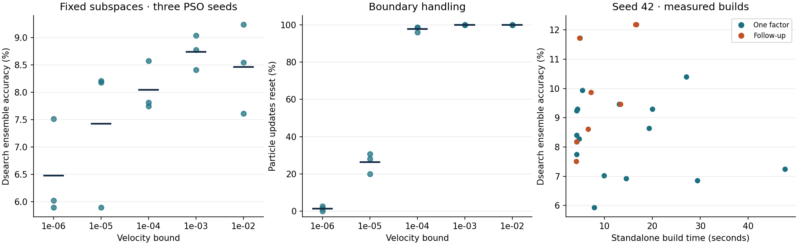
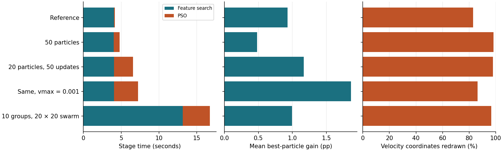

# Hyperparameter sensitivity on preserved 20News

**Increasing swarm size was the most cost-effective change tested.** On the three fixed reference subspaces, moving from 5 to 50 particles at five updates raised mean ensemble accuracy from 7.43% to 11.09% for about 0.65 additional build seconds. A ten-member configuration reached 12.55% at greater cost. Its equal-budget independent-random control reached 13.72%. These are Dsearch results on one known split. The experiment does not establish a generalization benefit from PSO.

### Design and budget

The original G=3, L=4, m=128, Tmax=4, Np=5, Imax=5 and vmax=10⁻⁵ were the reference. Throughout, α=1, ε=0.05, C₀=1, δq=0.01, Rq=2, inertia=0.9 and c₁=c₂=1.4. Every trial used the same fold-0 Dfit and Dsearch rows and the same 65,540 fit-observed input columns. The historical test accuracy was excluded from the analysis.

The first phase varied each requested factor independently through all proposed values. On the PSO sweep, the feature-stage root stayed 42 and the driver reused the exact selected columns. The feature-stage sweep held the PSO settings and its root seed fixed. Changing G changes both the number of candidate groups and the vote size. Fixed-order prefixes of the same ensemble isolate the voting contribution. Follow-up trials combined a few settings, repeated informative conditions with seeds 42, 43 and 44, and added a smaller speed bound to test whether repairs could be avoided. In the G=10 repeats, both stochastic stages used the indicated root and each PSO comparison used the corresponding matched subspaces.

All 25 one-factor, 15 follow-up and 9 confirmation executions completed. These 49 executions include reference repeats and diagnostic controls. Each phase had a local launch budget of 900, 600 and 240 seconds respectively. Recorded phase times were 209.03, 98.97 and 77.84 seconds, including diagnostic controls, so no scheduled run was skipped. The [complete inventory](measurement_tables.md) records every attempted configuration and seed, including poor results.

### Accuracy and cost

Three-seed means are shown below. Times use the reference OFAT, N50 confirmation, long-swarm follow-up and G10 matched-control confirmation phases. The feature cache reuses measurements of identical selections. The standalone build estimate adds that feature time once, measured PSO time including instrumentation, and construction time. Prediction, control fitting, coverage summaries, source loading and output writes are excluded from build time.

| Configuration | Feature s | PSO s | Build s | Initial vote | Final vote | Independent-random vote at equal fitness budget | Fitness calls per method |
|---|---:|---:|---:|---:|---:|---:|---:|
| Reference, 3 groups, 5×5 swarm | 4.05 | 0.10 | 4.15 | 6.48% | 7.43% | 7.57% | 90 |
| 3 groups, 50 particles × 5 updates | 4.02 | 0.79 | 4.81 | 8.68% | 11.09% | 10.19% | 900 |
| 3 groups, 20×50 | 4.07 | 2.51 | 6.57 | 7.77% | 8.98% | 10.22% | 3,060 |
| 3 groups, 20×50, vmax=0.001 | 4.07 | 3.17 | 7.24 | 7.77% | 10.02% | 10.22% | 3,060 |
| 10 groups, 20×20 | 13.15 | 3.58 | 16.73 | 10.02% | 12.55% | 13.72% | 4,200 |

The independent-random diagnostic starts from the same initial swarm and spends the exact remaining fitness budget on new independent, block-normalized models. It applies the same per-group accuracy selection and final hard vote. It exceeded the G=10 PSO result for each of the three seeds. With 50 particles and five updates, PSO exceeded the corresponding random control on two of three seeds. Ensemble accuracy can decrease even as the best search accuracy of every individual swarm is nondecreasing.

### Feature budget and ensemble size

- **Subspace width.** For seed 42, m=128, 256, 512 and 1,024 yielded fitted-vote accuracies of 46.85%, 58.05%, 68.25% and 74.37%. Final PSO voting yielded 8.18%, 5.93%, 6.92% and 6.85%. Build time rose from 4.15 to 29.37 seconds. At m=512 and 1,024, every particle update reset under the unchanged reference bound.
- **Candidates and rounds.** Increasing L from 4 to 50 raised fitted-vote accuracy to 52.55%, but the final vote reached 7.25% and the build cost 47.69 seconds. Tmax=10 and 20 yielded 7.02% and 9.30% final votes, with 9.89 and 20.03 second builds. Increasing these feature-search budgets gave inconsistent downstream returns.
- **Groups.** Varying G alone from 3 to 10 to 20 with seed 42 gave final votes of 8.18%, 9.47% and 10.40% in 4.15, 13.11 and 27.11 seconds. For the same trained ten-member reference-budget model, the first 1, 3, 5 and 10 members correctly classified 222, 225, 242 and 286 search documents. More votes helped in this case. Changing G in the full algorithm also alters adaptive weighting, feature overlap and total model searches.

### Velocity bound, normalization and provenance

The development value vmax=10⁻⁵ first appears in the November 17 smoke configuration at commit `9d1ae30`; the November 25 runner retained it. Chapter 3 specifies a positive bound and fixes inertia at 0.9. In 何政賢 (2024), printed p. 36, Table 5.2 of the local original PDF lists 50 particles, 100 updates, c₁=c₂=2 and w=0.9 for PSO-TRENB. It prints both position and velocity limits as 10⁻¹⁰ to 1. The study concerns a binary NB ensemble with an acceptance threshold. Its table supports the inertia citation. The symmetric development bound ±10⁻⁵ comes from this project. [NCKU thesis record](https://nckur.lib.ncku.edu.tw/handle/987654321/315615)

With M=20 and m=128, each particle contains 2,580 coordinates. The block-average prior is 1/20=0.05 and the block-average conditional is 1/128≈0.00781. Individual coordinates can be arbitrarily close to zero. A single invalid trial coordinate triggers a whole-particle reset before block normalization. This gives the smallest coordinates substantial influence over whether a move survives. Increasing m to 1,024 gives 20,500 coordinates and a mean conditional of 0.000977.

| vmax, fixed G=3, Np=5, Imax=5 | Mean initial vote | Mean final vote | Particle updates reset across three seeds |
|---:|---:|---:|---:|
| 0.000001 | 6.48% | 6.48% | 1.33% |
| 0.00001 | 6.48% | 7.43% | 26.22% |
| 0.0001 | 6.48% | 8.05% | 97.78% |
| 0.001 | 6.48% | 8.74% | 100% |
| 0.01 | 6.48% | 8.47% | 100% |

At the smallest bound the final vote had the same number correct as the initial vote for every seed. At the two largest bounds all updated particles were reinitialized. Any historical-best improvement across those updates therefore came from a fresh random position. The percentage of redrawn velocity coordinates measures a different event. For seed 42 it fell from 85.85% at 10⁻⁵ to 23.72% at 0.01 even as whole-particle resets increased. Post-normalization movement for accepted positions and movement including resets are reported separately in the local records. Empty accepted-move sets are recorded as null.

### Provisional settings and independent validation

Carry **G=3, L=4, m=128, Tmax=4, Np=50, Imax=5, vmax=10⁻⁵** as the low-cost candidate. Carry **G=10, L=4, m=128, Tmax=4, Np=20, Imax=20, vmax=10⁻⁵** only if a higher-cost comparison is feasible. Use the other reference parameters unchanged and retain the fitted and equal-budget random controls. Moving from the first candidate to the second bought 1.46 points of mean search accuracy at roughly 3.5 times the model-building cost.

Before checking additional outer folds, predeclare the candidates, seeds, resource ceiling, primary accuracy metric and tie rule. For a development-only independence check, one option is to reserve a stratified group-disjoint validation fold inside the current outer training data, rebuild Dfit/Dsearch and their vocabulary using only the remainder, train each prespecified candidate there, then score that validation fold once. Validate class coverage and keep identity groups intact at every split. The existing outer training data have already influenced this exploratory shortlist, so such a check is weaker than a frozen protocol on fresh data. Seek advisor agreement before introducing this evaluation design. No extra permanent partition was introduced.
